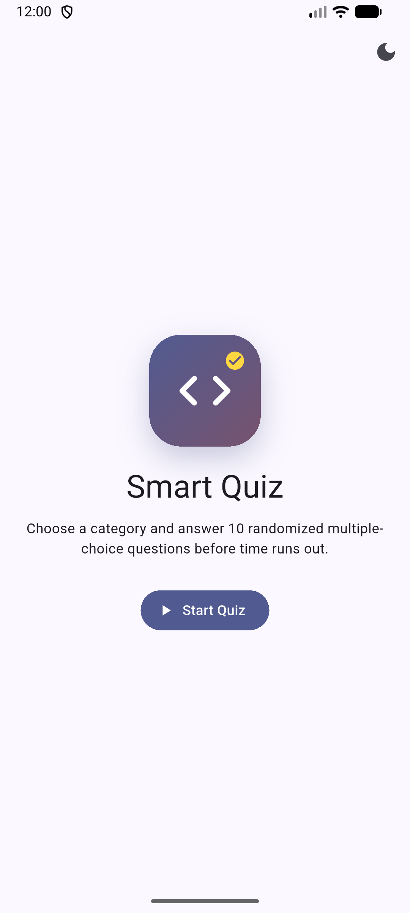
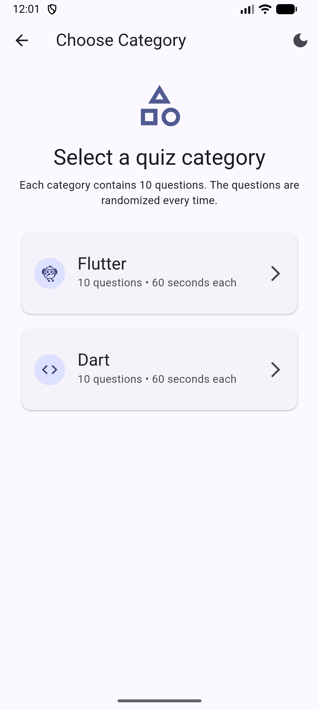
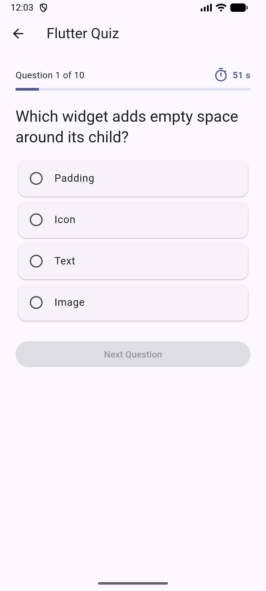
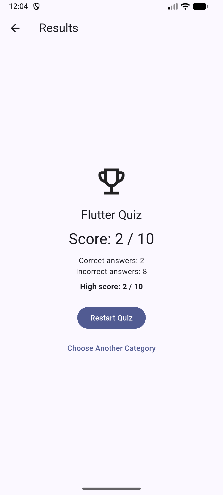

# Smart Quiz

Smart Quiz is a responsive Flutter quiz application. Users can select a category and answer 10 randomized multiple-choice questions within a time limit.

## Features

- Welcome screen with a custom Smart Quiz logo
- Flutter and Dart quiz categories
- 10 questions in every quiz
- Randomized question order
- One question displayed at a time
- Multiple-choice answer selection
- 60-second timer for every question
- Automatic advancement when time expires
- Score calculation
- Correct and incorrect answer counts
- Category-specific high scores
- Persistent high scores using SharedPreferences
- Persistent light and dark modes
- Restart quiz option
- Choose another category option
- Responsive Material Design interface

## Technologies Used

- Flutter
- Dart
- Material Design
- SharedPreferences
- Flutter Widget Testing

## Project Structure

```text
lib/
├── data/
│   └── questions.dart
├── models/
│   └── quiz_question.dart
├── screens/
│   ├── category_screen.dart
│   └── quiz_screen.dart
└── main.dart

test/
└── widget_test.dart

docs/
└── screenshots/
```

## Installation

1. Install Flutter and configure an Android emulator.
2. Clone or download this project.
3. Open the project folder in VS Code.
4. Install the dependencies:

```bash
flutter pub get
```

5. Run the application:

```bash
flutter run
```

## Testing

Run the automated widget tests:

```bash
flutter test
```

Run static analysis:

```bash
flutter analyze
```

## Build APK

Create a debug APK:

```bash
flutter build apk --debug
```

The generated APK is located at:

```text
build/app/outputs/flutter-apk/app-debug.apk
```

## Screenshots

### Welcome Screen



### Category Selection



### Quiz Screen



### Results Screen



## Quiz Content

The application contains 20 locally stored educational questions:

- 10 Flutter questions
- 10 Dart questions

Each quiz randomly presents the 10 questions belonging to the selected category.

## Bonus Features

All suggested bonus features are included:

- Timer for every question
- Randomized questions
- Category-based quizzes
- Persistent high scores
- Persistent dark mode